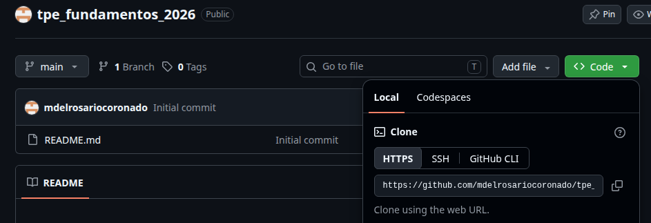

# tpe_fundamentos_2026

Los notebooks de prueba los recomendo nacho para probar que cosas incorporar al notebook final de entrega.

## Guia de uso
---
### Clonar el repositorio
git clone https://github.com/mdelrosariocoronado/tpe_fundamentos_2026.git
--- 

    cd tpe_fundamentos_2026 //pongan la direccion donde tengan clonado el archivo (ej dentro de carpeta "fundamentos/")

### Creen el entorno y luego abranlo
- en linux:

    crearlo: *python3 -m venv venv* 
    abrirlo: *source venv/bin/activate*
